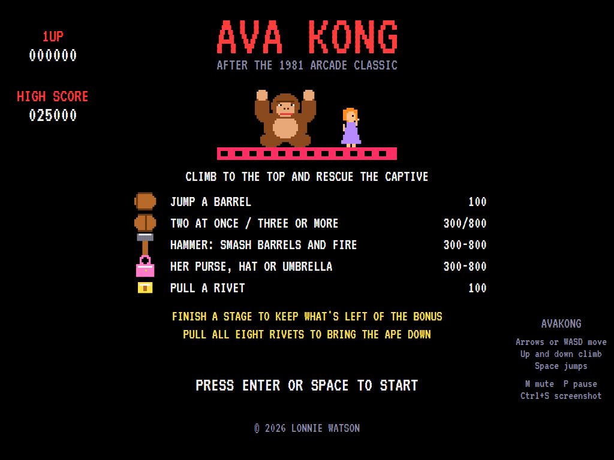
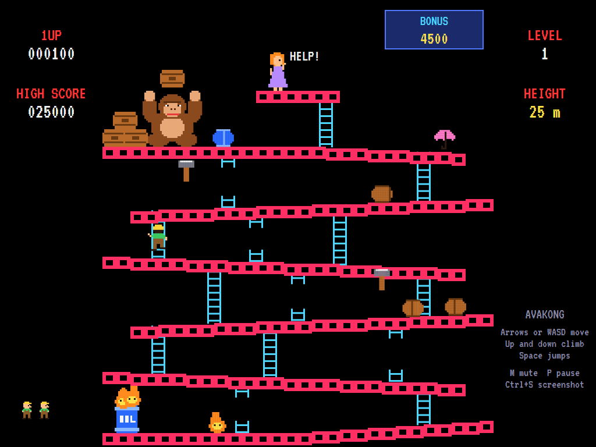
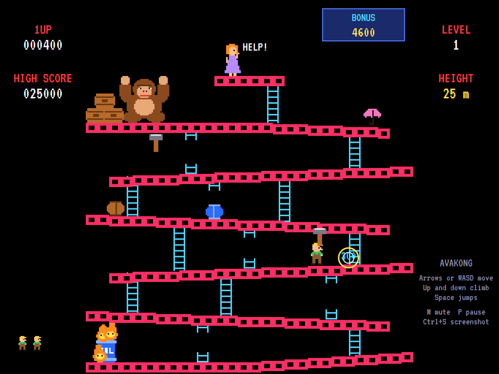
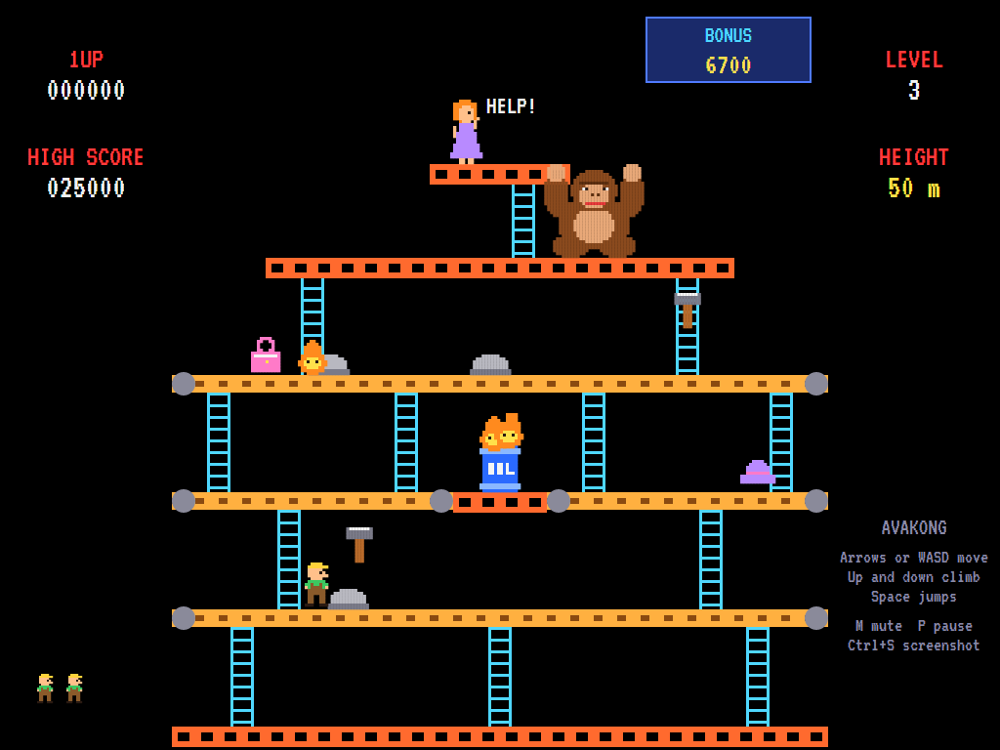
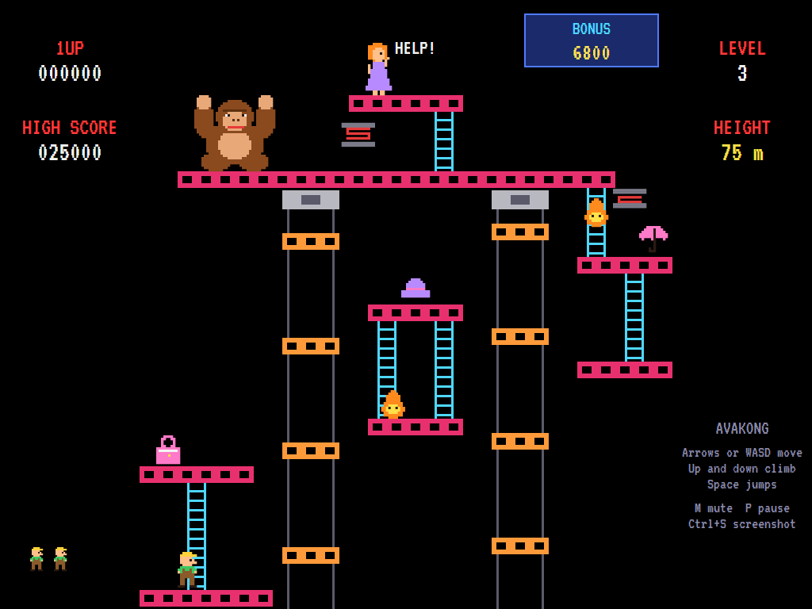
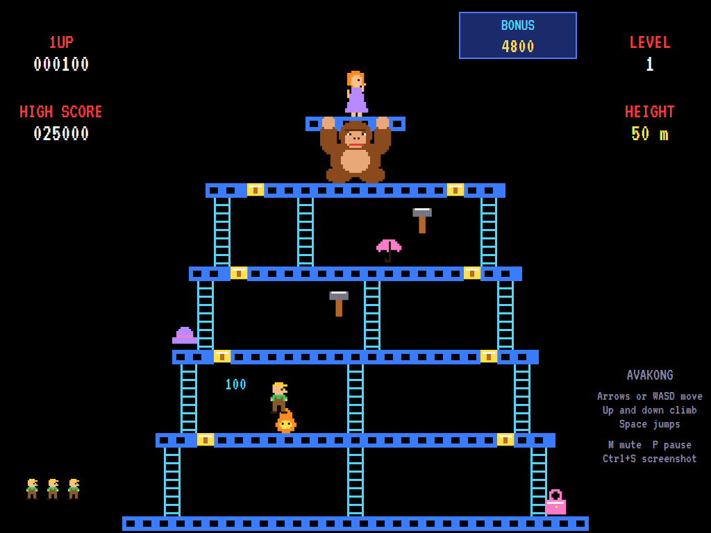

# AVAKong

[](https://github.com/Harlock123/AVAKong/actions/workflows/build.yml)

A climbing game in the style of Nintendo's 1981 arcade game **Donkey Kong**, built with .NET 10 and
Avalonia UI. A giant ape has carried off the captive to the top of a building site. Climb up to her:
jump the barrels he rolls down the girders, dodge the fireballs, ride the lifts, and pull the rivets
out from under him. The hero, the captive and the ape are this game's own characters.

## Features

- **Four kinds of stage**, each with its own layout:
  - **Girders**: six sloping girders. The ape rolls barrels down them; barrels drop off the ends and
    sometimes down a ladder, especially when you're below. His first barrel goes straight down to the
    drum at the bottom and lights it, and blue barrels light more fireballs.
  - **Conveyors**: belts carry you (and trays of cement) along. They change direction now and then, a
    fire burns in the middle, and the ape paces the top.
  - **Elevators**: islands, a lift shaft going up and one coming down, and springs that bound along the
    top girder and drop down the right-hand side. Ride a lift into the machinery at the top and it's
    over.
  - **Rivets**: walk or jump across all eight rivets to pull them, leaving gaps behind you. Pull the
    last one and the ape's floor gives way.
- **Levels** get longer as you go: girders and rivets first, then the elevators, then the conveyors,
  up to five stages a level, with barrels and fireballs getting quicker.
- **Jump** over barrels, fireballs and trays for 100 points, 300 for two at once, and 800 for three
  or more. Land more than a little below where you jumped from, or walk off a girder's end, and you
  don't get up.
- **Ladders**: some are broken and can't be climbed, but barrels and fireballs can still use them.
- **The hammer**: grab one (they hang just out of reach, so jump) and for ten seconds you smash
  barrels, fireballs and trays for 300 to 800 points. You can't climb or jump while you hold it.
- **Her purse, hat and umbrella** are worth 300, 500 and then 800 points.
- **The bonus** counts down from the start of each stage. Finish the stage to bank what's left; let it
  reach zero and you lose a life. "How high can you climb?" shows each new height.
- **Music** for each kind of stage and for the hammer, a title tune, and stage-clear and rivet
  fanfares, all original and mixed by OpenAL.
- **Attract mode**: leave the title alone for 15 seconds and a computer player plays a demonstration,
  with all its sounds. It plans its route up the ladders, times its jumps over barrels, and waits for
  a ladder to be clear before climbing.
- **Three lives**, a bonus life at 10,000, and a **top-ten high-score table** with arcade-style
  initials entry. The table records the level and height you reached.
- **Any window size**: the screen scales to fit, letterboxed. **Ctrl+S** saves a screenshot.
- **One self-contained executable** per platform: Windows, macOS and Linux on Intel/AMD and ARM.

The stage layouts, sprites, sounds and tunes are all this game's own.

## Screenshots

| Title screen | The girders | The hammer |
|:------------:|:-----------:|:----------:|
|  |  |  |
| The ape, the captive, and what everything is worth. | Barrels rolling down; the drum alight. | A barrel smashed for 300. |

| Conveyors | Elevators | Rivets |
|:---------:|:---------:|:------:|
|  |  |  |
| Belts, trays of cement and the fire in the middle. | The lift shafts and the springs. | A rivet pulled; seven to go. |

The screenshots are made by the tests, which play the game in a real (headless) window; see
[Tests](#tests).

## Download and run

Ready-to-run builds for Windows, macOS and Linux, on both Intel/AMD and ARM, are on the
[Releases page](https://github.com/Harlock123/AVAKong/releases/tag/latest). **Latest build** is
rebuilt on every push to `main`. Each download is one self-contained executable: no .NET install is
needed.

| Platform | Archive |
|---|---|
| Windows | `AVAKong-win-x64.zip`, `AVAKong-win-x86.zip`, `AVAKong-win-arm64.zip` |
| macOS | `AVAKong-osx-arm64.tar.gz` (Apple silicon), `AVAKong-osx-x64.tar.gz` (Intel) |
| Linux | `AVAKong-linux-x64.tar.gz`, `AVAKong-linux-arm64.tar.gz`, `AVAKong-linux-arm.tar.gz` |

```bash
tar -xzf AVAKong-linux-x64.tar.gz     # or linux-arm64, linux-arm, osx-arm64, osx-x64
./AVAKong
```

On Windows, unzip and run `AVAKong.exe`. On macOS, if Gatekeeper refuses to open it, run
`xattr -d com.apple.quarantine AVAKong` once. Run with `--no-audio` for silence.

**Sound** comes through OpenAL Soft, built in for every platform. In a virtual machine the game
detects it and uses a larger audio buffer, so the sound doesn't break up.

**Gamepads** use SDL2, which is bundled for Windows, macOS and Intel/AMD Linux. ARM Linux builds need it
installed; without it the keyboard still works:

```bash
sudo apt install libsdl2-dev            # Debian / Ubuntu / Raspberry Pi OS
sudo pacman -S --needed sdl2-compat     # Arch / Omarchy
```

## Controls

| Input | Action |
|-------|--------|
| **Left / Right** or **A / D** | Walk |
| **Up / Down** or **W / S** | Climb a ladder |
| **Space**, **Ctrl**, **Z** or **X** | Jump |
| **Enter** / **Space** | Start a game |
| **P** / **Esc** | Pause (Esc again to quit) |
| **M** | Mute |
| **Ctrl+S** / **Cmd+S** | Save a screenshot to the Pictures folder |

**Gamepad**: the left stick or D-pad walks and climbs, **A**, **B** or **X** jumps, **Start** starts and
pauses, **Back** (while paused) quits.

**Entering initials**: type letters, or dial with **Up**/**Down** and accept with **Space**; **Left** /
**Backspace** go back; **Enter** finishes.

## Scoring

| What | Points |
|---|---:|
| Jumping a barrel, fireball or tray | 100 |
| Jumping two at once / three or more | 300 / 800 |
| Smashing a barrel with the hammer | 300 or 800 |
| Smashing a fireball / a tray | 500 / 300 |
| Purse, hat or umbrella | 300 (level 1), 500 (level 2), 800 |
| Pulling a rivet | 100 |
| Finishing a stage | Whatever is left of the bonus |

## Tests

```bash
dotnet test AVAKong.slnx
```

The engine has no UI and runs in fixed 60 Hz steps, so it plays the same at any frame rate, and a seed
always plays the same game. The tests check:

- every stage can be climbed;
- walking up and down the slopes, falling off ends, the jump's height and carry, and ladders (and
  broken ones);
- barrels rolling downhill, jump points, being hit and starting the stage again, and the ape's first
  barrel lighting the drum;
- the hammer;
- her belongings;
- the bonus running down and being banked;
- pulling rivets (and falling through the gaps), with the ape falling and the next level;
- the belts, the trays and the fire;
- the lifts and their machinery, and the springs;
- the bonus life, and the high-score table;
- the title tune, the demonstration's sound, and pausing the music;
- every sound and sprite.

The computer player (the attract-mode one) must get past the girders in at least two of four games.

The screenshot tests draw the real screen in a headless window. To refresh the README's pictures:

```bash
KONG_SHOTS=$PWD/Images dotnet test tests/AVAKong.Tests --filter ScreenshotTests
```

## Building

```bash
dotnet build AVAKong.slnx
dotnet run --project src/AVAKong
```

Needs the .NET 10 SDK. The sounds are made by `tools/make_sounds.py` (standard-library Python):
`python3 tools/make_sounds.py` rewrites `src/AVAKong/Sounds`.

## Project structure

```
AVAKong/
├── AVAKong.slnx
├── src/AVAKong/
│   ├── Engine/
│   │   ├── GameEngine.cs          # States, scoring, the bonus life and the music
│   │   ├── GameEngine.Play.cs     # Walking, jumping, climbing and falling, the hammer, rivets,
│   │   │                          # the bonus, and moving from stage to stage
│   │   ├── GameEngine.Enemies.cs  # The ape, barrels, fireballs, trays, springs, lifts and belts
│   │   ├── Entities.cs            # The hero and everything that can hit them
│   │   ├── AttractPilot.cs        # The computer player for the demonstration (and the tests)
│   │   ├── HighScoreTable.cs, InitialsEntry.cs
│   │   ├── InputHandler.cs, ControllerManager.cs  # Keys and an SDL2 gamepad
│   │   └── SoundManager.cs        # Effects, tunes and stage music through OpenAL
│   ├── Audio/                     # The OpenAL engine (from the author's AVABand)
│   ├── Models/                    # The four stage layouts, and the pixel art
│   ├── Views/                     # The screen: the site, the climbers, panels, title and tables
│   └── Sounds/                    # The synthesised effects and tunes
├── tests/AVAKong.Tests/           # Gameplay and screenshot tests
├── tools/make_sounds.py
└── Images/                        # Screenshots
```

## About and licence

AVAKong © 2026 Lonnie Watson, under the [MIT License](LICENSE).

*Donkey Kong* © 1981 Nintendo; the name belongs to its owner. AVAKong is an independent, unofficial
game in its style. Its stage layouts, characters, sprites, sounds, tunes and code are its own; nothing
is taken from the arcade machine's program, graphics or sound. It is not affiliated with or endorsed by
any rights holder.

Bundled components keep their own licences: the VT323 font (SIL Open Font License 1.1, by Peter Hull;
`src/AVAKong/Assets/Fonts/VT323-OFL.txt`), OpenAL Soft (LGPL-2.0-or-later; loaded as a separate
library; `src/AVAKong/Audio/native/COPYING-openal-soft.txt`), and the MIT-licensed Avalonia,
Silk.NET, NVorbis, NLayer and SDL2-CS (with SDL2 under the zlib licence).
